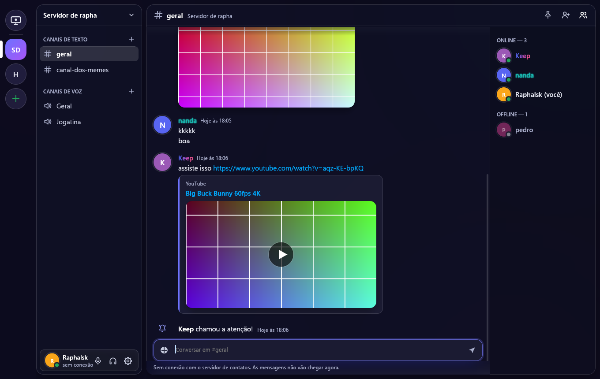
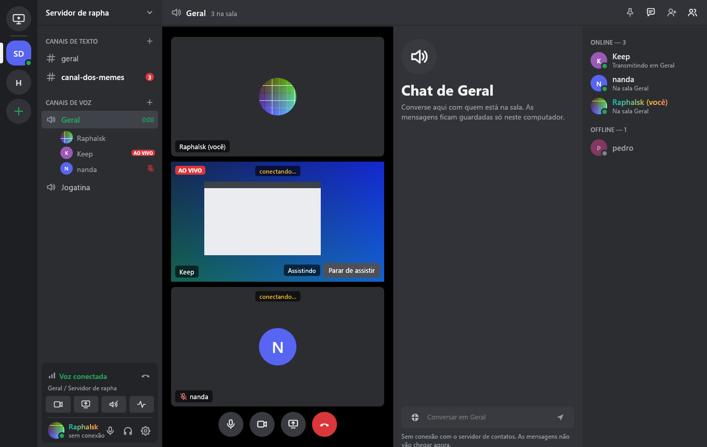
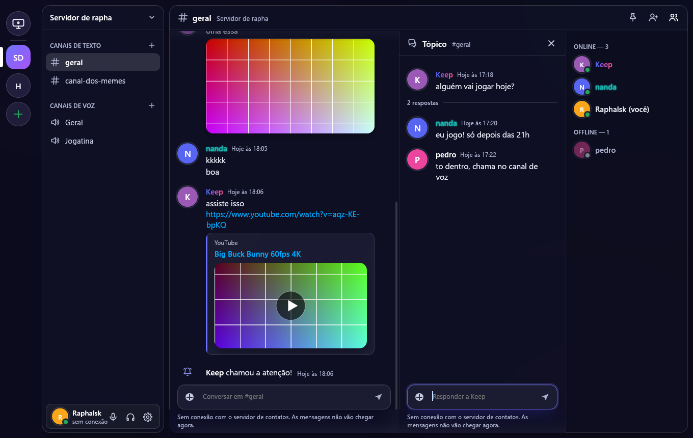
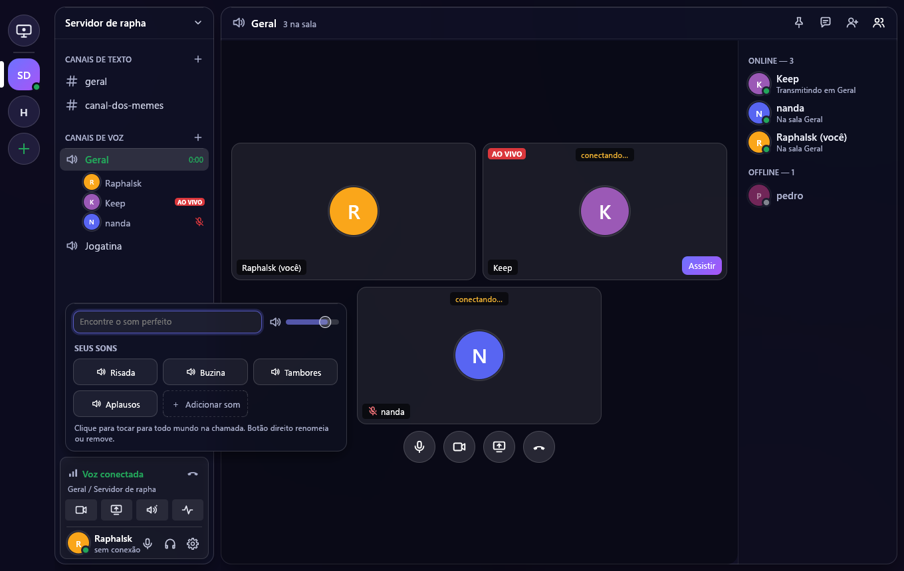
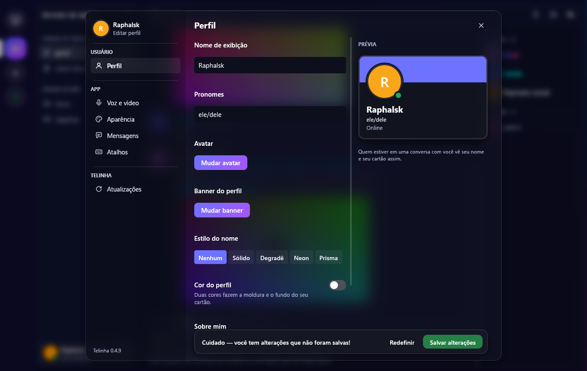
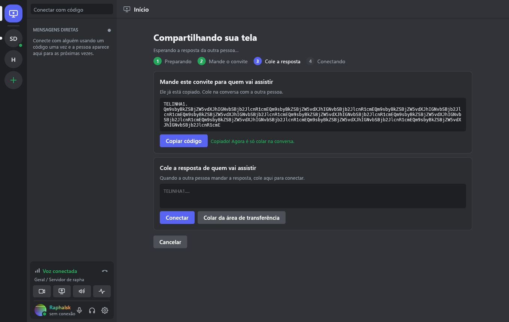
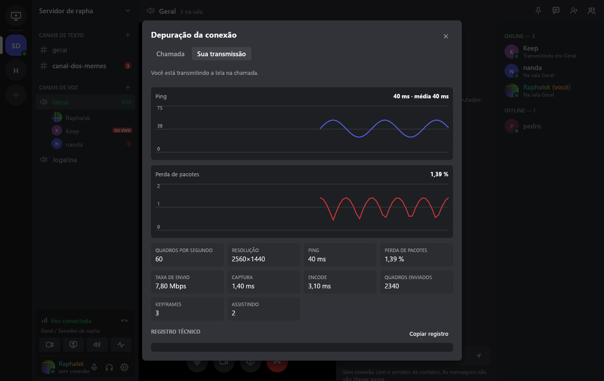
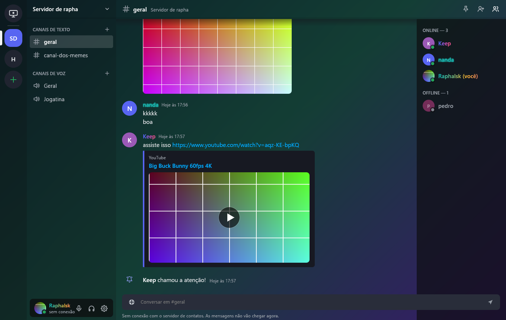
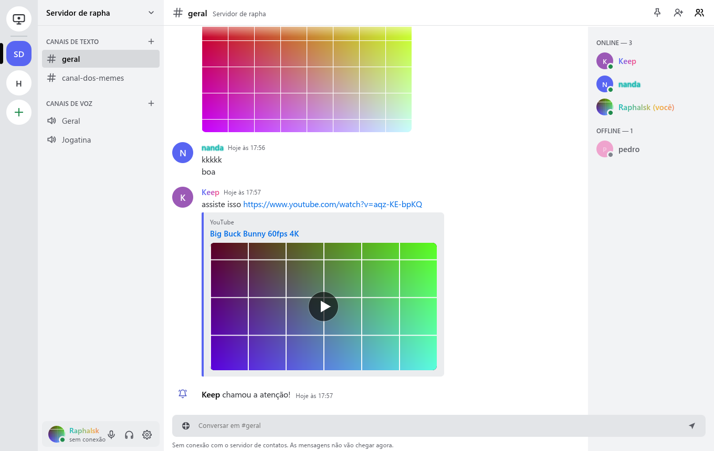

<div align="center">

# Telinha

**Peer-to-peer screen sharing, voice and chat for Windows. No accounts and no servers to host.**

[](https://github.com/Raphalsk050/Telinha/releases/latest)




</div>

Telinha is a small desktop app for sharing your screen, or a single window with its own sound,
with the people you talk to. It works like a group chat app, with servers, text channels, voice
rooms, direct messages and a live stage for screens and cameras. Video and voice go straight from
one computer to the other. Nothing is relayed through a server of ours, and there is no sign-up.

It ships as **one portable `Telinha.exe`** that updates itself.

> The interface is in Brazilian Portuguese.

## Features

<table>
<tr>
<td width="50%"></td>
<td width="50%"></td>
</tr>
<tr>
<td><b>Voice rooms with a stage.</b> Join a room, turn on the camera, share a screen or one window.
Everyone can watch any stream inside the app, or open it full screen.</td>
<td><b>Text channels and DMs.</b> Pictures, files, link previews, replies, threads, pinned messages
and "nudges". History stays on each computer.</td>
</tr>
<tr>
<td></td>
<td></td>
</tr>
<tr>
<td><b>Soundboard.</b> Add your own sounds and play them to everyone in the call.</td>
<td><b>Profiles.</b> Avatar, banner, pronouns, profile colours and name effects (solid, gradient,
neon, prism), with a live preview and an unsaved-changes bar.</td>
</tr>
<tr>
<td></td>
<td></td>
</tr>
<tr>
<td><b>Connect with a code.</b> The first time, you swap a code with the other person. After
that they are a contact and show up online.</td>
<td><b>Connection debug.</b> Live ping and packet loss, fps, resolution, bitrate, capture and
encode times, and a log you can copy.</td>
</tr>
</table>

Also included:

- **Window audio on its own.** Sharing a window sends only that program's sound, captured per
  process, so the call does not echo back to the people watching.
- **Hardware encoding.** NVENC on NVIDIA cards, Media Foundation (AMD, Intel) everywhere else,
  with H.264, HEVC and AV1 where the GPU has them.
- **Themes.** Dark, light and glass, plus 14 gradient themes such as Aurora, Ocean and Neon,
  with zoom and density settings.

   

- **Global shortcuts** for mute, deafen, push-to-talk, sharing and leaving the call, recorded
  from any key, the numeric keypad included.
- **Notifications.** Windows toasts, unread counts, taskbar flash and a ringing card for calls.
- **Self-update.** The app checks GitHub releases and swaps itself once no call or share is
  running.

## Download

1. Grab `Telinha.exe` from the [latest release](https://github.com/Raphalsk050/Telinha/releases/latest).
2. Run it. There is no installer. Settings and history live in `%APPDATA%\Telinha`.
3. Click the screen icon at the top left, start a connection and send the code to a friend.

Requires Windows 10 or 11, 64-bit.

## How it works

```
 ┌──────────────── Telinha.exe (Rust, egui) ────────────────┐
 │  window & UI  ─  hub (presence, chat, calls)  ─  voice   │
 └──────┬──────────────────────┬────────────────────┬───────┘
        │ child process        │ encrypted MQTT     │ WebRTC (libwebrtc)
        ▼                      ▼                    ▼
  telinha.exe (C++)     public MQTT brokers    voice, camera and
  capture + encode      (signaling only)       files, peer to peer
  screen streams, P2P
```

- **Signaling.** Every contact and every server gets its own encrypted channel over a few public
  MQTT brokers. It carries presence, chat, call setup and stream codes, never audio or video.
- **Voice and camera** run on libwebrtc as a mesh between everyone in the call.
- **Screen streams** come from a separate C++ engine, `telinha.exe`, bundled inside the app.
  It captures with DXGI desktop duplication or Windows Graphics Capture, takes audio with WASAPI
  (process loopback for a single window), encodes on the GPU, and fans one encoded stream out to
  every viewer.
- **Ports.** Each call or stream binds a random window of 20 UDP ports between 51200 and 59999
  and picks a new one when a connection attempt fails. There is nothing to forward on the
  router. Two networks that are both behind carrier-grade NAT may not reach each other.

## Repository layout

| Path | What is there |
| --- | --- |
| `client/app` | The app (crate `telinha`): window, views, themes, glass blur on the GPU |
| `client/core` | No UI: vault, contacts, servers, chats, signaling, transfers, updater |
| `client/voice` | Calls on libwebrtc, microphone and speakers, camera, soundboard |
| `client/vendor/webrtc-sys` | Patched bindings that add a Media Foundation H.264 decoder |
| `src/`, `include/`, `tools/telinha` | The C++ capture, encode, transport and receive engine |
| `design/sketch` | A live HTML copy of the interface for trying UI ideas |
| `desktop/` | The previous Electron app, kept for reference |

## Building from source

You need Visual Studio 2022 (MSVC v143), CMake, and a stable Rust toolchain.

Build the engine and the portable app in one go:

```powershell
.\build-rust.ps1
```

The result is `client\dist\Telinha.exe`, about 56 MB with the engine inside. Other modes:

```powershell
.\build-rust.ps1 -Run    # build the engine and open a development build
.\build-rust.ps1 -Test   # run the Rust tests
```

To test without touching your real profile, point the app at a scratch folder:

```powershell
$env:TELINHA_DATA_DIR = "$env:TEMP\telinha-test"; .\build-rust.ps1 -Run
```

The engine alone builds with CMake presets (`cmake --list-presets` shows the rest, including
address and thread sanitizer builds):

```powershell
cmake --preset msvc-release; cmake --build --preset msvc-release; ctest --preset msvc-release
```

Screenshots in this README come from the app's own snapshot test, which draws the real
interface headless with sample data:

```powershell
cd client; cargo test -p telinha --test snapshots -- --nocapture   # writes client/target/snapshots/*.png
```

## Releases

The version lives in `version.json` and is only changed by hand. `RELEASE_NOTES.md` lists what
changed since the last release under Features, Improvements and Fixes. A push to `main` with a
version above the last release, and every CI job green, tags it and publishes a GitHub release
with `Telinha.exe` and those notes. Installed apps pick it up within a minute.
